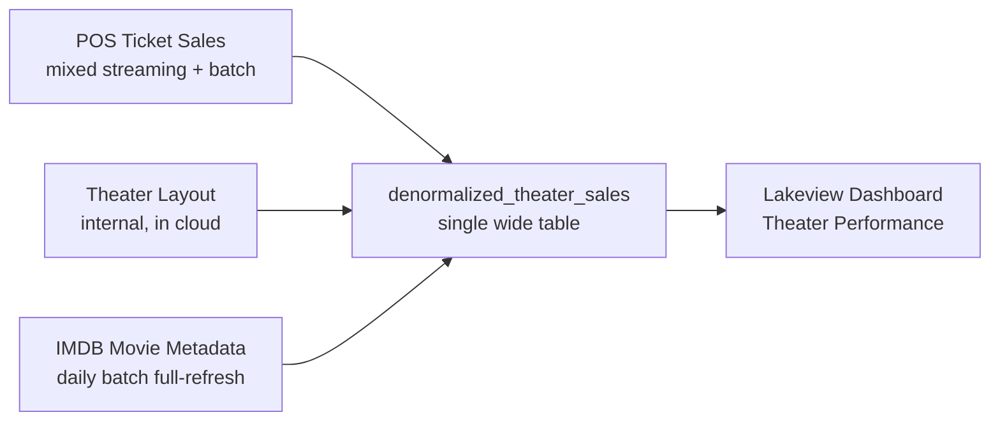

# FDE Interview Packet: Theater Sales Review

A Declarative Automation Bundle that provisions an end-to-end theater sales analytics environment for the FDE Build, Demo & Delivery interview. The candidate receives the as-is implementation as a starting point and builds a real POC of an architectural component that solves a business problem as defined in their scenario prompt.

**Ready to deploy?** Jump to **[SETUP.md](SETUP.md)**.

## As-Is Architecture

The scaffold is the customer's existing implementation — a working end-to-end pipeline you can explore before proposing changes.

| Asset | Description |
|-------|-------------|
| **3 source tables** | `theater_layout` (clean), `imdb_movie_metadata` (clean), `pos_ticket_sales` (data-quality issues seeded per POS source) |
| **1 denormalized table** | `denormalized_theater_sales` — naive inner-join that silently drops orphan rows |
| **2 jobs** | `seed_theater_data` (ingest) → `build_denormalized_theater_sales` (transform) |
| **1 Lakeview dashboard** | `Theater Performance` — KPIs roll up; users filter by theater; reports the past but doesn't let users act |
| **1 Databricks App** | `reel-insights` — bare bones app that can be extended / modified as needed |

For the editable diagram, see [`reference/fde_design_and_build_asis_architecture.excalidraw`](reference/fde_design_and_build_asis_architecture.excalidraw) or open it directly in [Excalidraw](https://excalidraw.com/#json=XoIQCpDoQJLFVXLSI3FAy,sLHBahpjIT5TF7fXiYB8bg).

## What the Customer Is Asking For

The customer believes their problem is the dashboard. **Your job is to read between the lines** — the gaps in this scaffold are the gaps your proposed architecture needs to address. See the candidate prompt for details.

## Fast Iteration

Not every change requires a full cold start (`deploy` → `seed_theater_data` → `build_denormalized_theater_sales`).

| Tier | When to use | Typical commands |
|------|-------------|------------------|
| **Dashboard only** | Editing `src/dashboard/theater_performance.lvdash.json` | `databricks bundle deploy -t dev --force`. Skip both jobs. |
| **Transform only** | Source tables exist; you changed the transform | `bundle deploy` then `bundle run -t dev build_denormalized_theater_sales` |
| **Source data** | You changed an ingest script | `bundle deploy` → `bundle run -t dev seed_theater_data` → `bundle run -t dev build_denormalized_theater_sales` |
| **App** | Iterating on the Databricks App | Use the app's own dev loop; skip jobs unless you also changed source/transform |
| **Full cold start** | New workspace or large changes | `bundle deploy -t dev --force`, then both jobs in order |

## Deployment

For prerequisites, step-by-step setup, and verification queries, see **[SETUP.md](SETUP.md)**.
